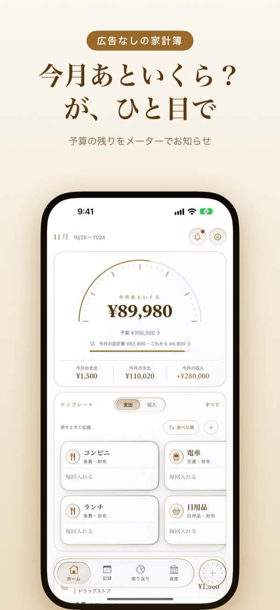
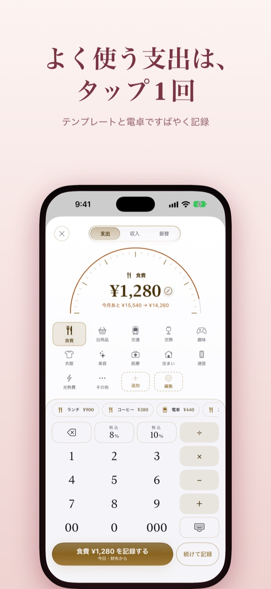
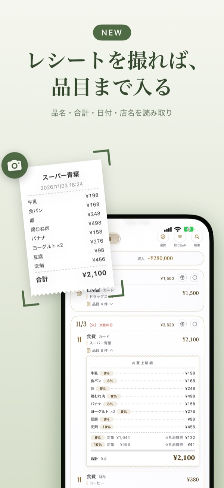
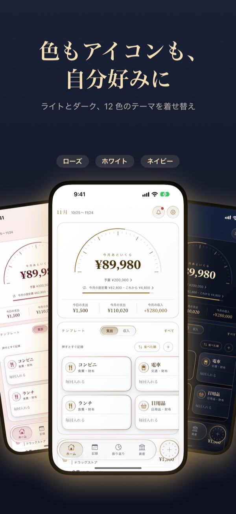
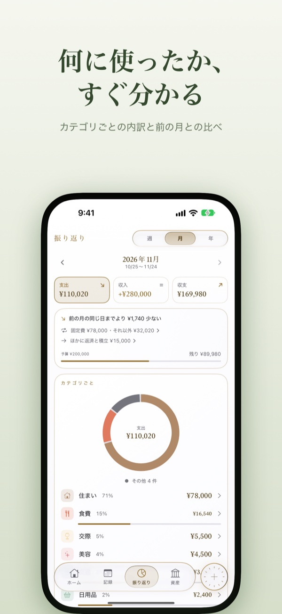
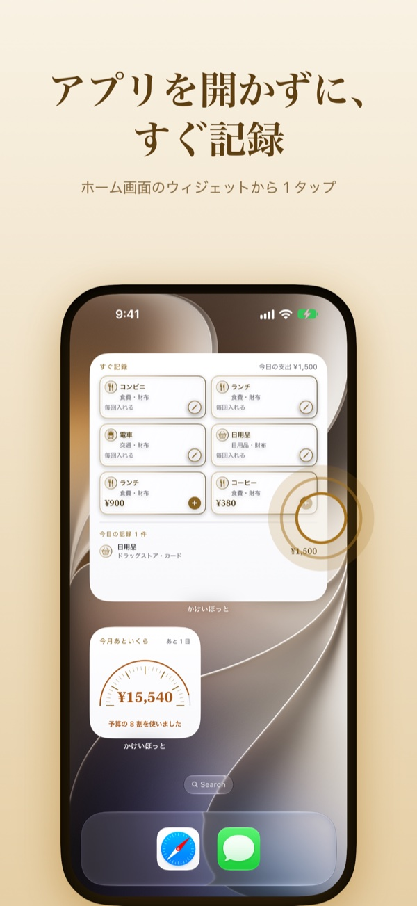

# kakeibot-support

家計簿アプリ「かけいぼっと」のサポートページとプライバシーポリシー。

## ✨ 機能

| ホーム | 1 タップの記録 | レシートの読み取り |
| :---: | :---: | :---: |
|  |  |  |

| 着せ替えのテーマ | 振り返り | ウィジェット |
| :---: | :---: | :---: |
|  |  |  |

## 🗺️ 全体像

| ページ | ファイル | 中身 |
| --- | --- | --- |
| [サポート](https://yossibank.github.io/kakeibot-support/) | `index.html` | よくある質問と、お問い合わせのフォーム |
| [プライバシーポリシー](https://yossibank.github.io/kakeibot-support/privacy.html) | `privacy.html` | 集める情報と、データの保存先 |
| 公開の仕方 | GitHub Pages | `main` のファイルをそのまま公開 |
| アプリの本体 | 非公開のリポジトリ | |
